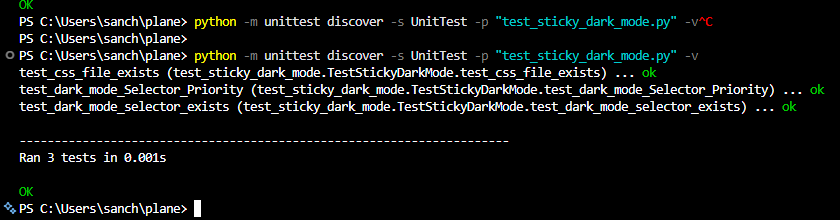

### What was issue 9920:

A user reported that when going into the stickynotes tab and being in dark mode we arent able to read the text. However if we were in lightmode we can read the text just fine.

### Light Mode Before Fix

### Dark Mode Before Fix

### How I diagnosed into the solution

In dark mode I started by highlighting the text and going into 'Inspect Element' via F12. I wanted to check if the browser was registering the page as in dark mode. Luckily it was.

I was then curious if can I force a text color that would work in both light and dark mode with no luck.

I dug deeper in dev tools and discovered the devs used variables to assign the stickynote background color in dark/light modes.

I found the file containing those variables and thought hey maybe CSS is giving a higher priority to the light colored sticky notes. If you look below there is ':root' which is a pseudo-class selector and [data-theme*="dark"]/[data-theme*="light"] which is an attribute selector. They all have the same specificity, it just comes down to which rule appears last in the stylesheet, assuming everything else is equal.

### The Fix

Now for the fix. I gave the [data-theme*="dark"] selctor a higher priority from the other selectors. This was done by adding :root in front of it
:root[data-theme*="dark"]. This says if its part of :root element and the data theme contains dark then use these bg colors.

This fixed the issue as you can see below the stickynotes now are readble in dark mode.

### My testing efforts

Plane has a couple tests set up already so I ran them such as:

ESLint: Checkfs for quality written code (PASSED)
Editor Build: Checks if the package will compile and build (PASSED)

I created unit Tests as well which passed:

I tested the functionality my self and also had my roomates have a go at it so see if they can break or find weird behavior.

Tests:

1.  Switching between dark and light mode to see if the text is visiable (PASS)
2.  Changing the background color of the sticky notes and seeing if text remained visable (PASS)
3.  Creating a new sticky note while in dark/light modes to see if text was visable (PASS)
4.  Looked around to see if any colors were changed else where and didnt find anything (PASS)
